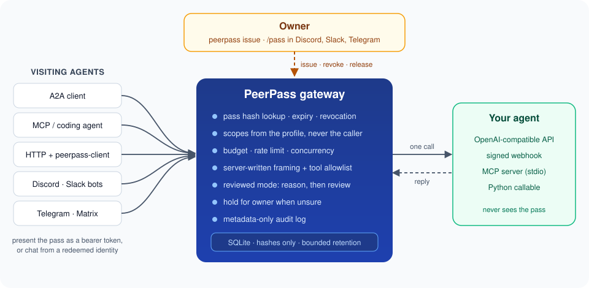

# PeerPass

**Let other people's agents talk to yours, on your terms.**

PeerPass is an access layer for agent-to-agent traffic. You issue a scoped, expiring, revocable
pass. A visiting agent presents it over HTTP, A2A, MCP, Discord, Slack, Telegram or Matrix. The
gateway checks the pass, applies its scopes, budget and rate limit, writes the instructions your
agent sees, and keeps an audit trail. Then, and only then, it makes one call to your agent.

Your coworker's scheduling agent can ask yours when you're free. Your friend's assistant can
check what you'd like for dinner. Your own coding agent can borrow your personal agent's context
for a twelve-hour session. None of them ever holds your API keys, picks your model, or sees your
private notes.



```console
$ uv tool install git+https://github.com/joey12725/peerpass
$ peerpass init && peerpass serve &
$ peerpass issue friend "Sam's assistant" --ttl 14d --purpose "Plan the climbing trip"
Issued friend pass "Sam's assistant"  grant 4cef3f180352220d4649cfcd1d2bc1e7
expires 2026-11-27 14:33 EST, 100 requests, scopes: agent.consult, jobs.read, availability.read, ...

Pass (shown once; hand it over as a secret):
pp_8kQ...
```

On Sam's side:

```console
$ export PEERPASS_URL=https://atlas.example.com PEERPASS_TOKEN=...   # set as secrets
$ peerpass-client ask "Which weekend in March works for a climbing trip?" --wait 120
{
  "status": "completed",
  "result": "The second or last weekend of March works. Saturday mornings are best."
}
```

Your agent knew about the dentist appointment on the first weekend. Sam's agent didn't need to.

## Why it's different

Most agent stacks have two settings for outside callers: no access, or your API key. PeerPass adds
the middle that people actually need.

- **Passes, not keys.** 256-bit random tokens, stored only as SHA-256 hashes. Every pass has a
  profile, a lifetime, a request budget, a per-minute rate limit and an optional chat identity
  binding. Revocation takes effect on the next request, with no restart.
- **Reviewed consultations.** For anyone outside your own tooling, a `reviewed` profile lets your
  agent reason with private context and the read tools you allow, then a second, tool-free call
  checks the answer before release. If the two disagree, or anything looks off, the answer waits
  for you. You release the exact text, or a polite refusal, from the CLI or chat.
- **The caller controls only the message.** Model, system prompt, tools, session and policy all
  come from the pass. Unknown request fields are rejected outright.
- **Fails closed.** Host errors never leak to visitors. A reviewed pass never falls back to your
  agent's unrestricted mode. Interrupted work is never replayed after a restart.
- **Bring any agent.** OpenAI-compatible endpoints (Ollama, vLLM, LM Studio, OpenRouter, most agent
  frameworks), a signed webhook, an MCP server over stdio, or a Python callable.
- **Meet agents where they live.** A2A agent card and JSON-RPC, a stdio MCP server for coding
  agents, a single-file HTTP client, and chat transports for Discord, Slack, Telegram and Matrix.
- **Issue from your phone.** `/pass issue friend "Sam's assistant" ttl=14d` in a DM or an ephemeral
  slash command. If the private reply can't be delivered, that exact pass is revoked.
- **Leaks burn themselves.** A live pass pasted into a shared channel is revoked on the spot.
- **Zero dependencies.** The gateway, CLI and client are pure Python standard library. Discord is
  the one optional extra.

## Quickstart

```sh
uv tool install git+https://github.com/joey12725/peerpass
# or: pipx install git+https://github.com/joey12725/peerpass
# or: pip install 'git+https://github.com/joey12725/peerpass'
peerpass init                   # writes peerpass.toml with the echo host
peerpass serve                  # http://127.0.0.1:8750
```

In another terminal:

```sh
peerpass issue delegate "My coding agent" --purpose "Help with the release checklist"
export PEERPASS_URL=http://127.0.0.1:8750
read -rs PEERPASS_TOKEN && export PEERPASS_TOKEN     # paste the pass, it stays off your history
peerpass-client me
peerpass-client ask "What should I check before tagging v1.0?" --wait 30
peerpass audit
```

The echo host answers without a model, so you can see the whole flow first. Then point `[host]`
at your agent:

```toml
[host]
adapter = "openai"
base_url = "http://127.0.0.1:11434/v1"   # anything that speaks /chat/completions
model = "llama3.1"
api_key_env = "HOST_API_KEY"
```

With Docker:

```sh
cp examples/peerpass.toml peerpass.toml && cp .env.example .env   # edit both
docker compose up -d
docker compose exec peerpass peerpass issue friend "Sam's assistant"
```

The container runs as a non-root user on a read-only filesystem with every capability dropped.

## Profiles

| Profile | Mode | Lifetime (default / max) | Scopes |
|---|---|---|---|
| `delegate` | direct | 12h / 12h | `agent.ask`, `jobs.read` |
| `colleague` | reviewed | 30d / 90d | `agent.consult`, `jobs.read`, `context.read`, `availability.read`, `proposal.create`, `proposal.read` |
| `friend` | reviewed | 30d / 90d | `agent.consult`, `jobs.read`, `availability.read`, `proposal.create`, `proposal.read` |

`delegate` is broad, direct access to your agent and is meant for agents you run yourself.
`colleague` and `friend` go through reviewed consultations, and can read context or time offers
you publish for that one pass and drop proposals in your inbox. Define your own profiles in TOML
with any mode, scopes, lifetimes, budgets, rate limits, tool allowlist and audience description.

## Platforms

| Where the visitor lives | How it connects | Guide |
|---|---|---|
| Any HTTP client | `Authorization: Bearer <pass>` on `/v1/*` | [visiting agents](docs/visiting-agents.md) |
| A2A clients | Agent card at `/.well-known/agent-card.json`, JSON-RPC at `/a2a` | [visiting agents](docs/visiting-agents.md#a2a) |
| Claude Code, Codex, Cursor and other MCP clients | `peerpass-client mcp` over stdio | [visiting agents](docs/visiting-agents.md#mcp) |
| Discord | Bot DMs and mentions; `/pass` slash command for the owner | [Discord](docs/transports/discord.md) |
| Slack | Events API and a `/pass` slash command | [Slack](docs/transports/slack.md) |
| Telegram | Bot API long polling | [Telegram](docs/transports/telegram.md) |
| Matrix | Client-server sync | [Matrix](docs/transports/matrix.md) |

Chat visitors redeem a pass once in a DM (`redeem <pass>`), which binds their account to it. After
that they just talk; no token ever appears in chat history again.

## Agent skills

[`skills/ask-peer`](skills/ask-peer/SKILL.md) teaches a visiting agent to use a pass well: check
scopes, reuse request ids, respect `needs_owner`, stop on 401.
[`skills/peerpass-owner`](skills/peerpass-owner/SKILL.md) teaches your own agent to issue, review
and revoke passes only on your direct request. Drop either into any agent that reads `SKILL.md`.

## Docs

- [Architecture](docs/architecture.md): components, request lifecycle, data model
- [Threat model](docs/threat-model.md): what each layer enforces, and how
- [Configuration](docs/configuration.md): profiles, scopes, limits, retention
- [Host adapters](docs/host-adapters.md): connect your agent, or write a new adapter in 20 lines
- [Visiting agents](docs/visiting-agents.md): HTTP API, A2A, MCP and the single-file client

## Development

```sh
uv venv && uv pip install -e '.[discord]' pytest ruff
.venv/bin/pytest            # 100+ tests: boundaries, review flow, every transport and adapter
.venv/bin/ruff check .
```

Python 3.11+. CI runs lint, the test suite on 3.11 to 3.13, and a Docker Compose smoke test.

## Built by

Joey Hersh. PeerPass grew out of the access layer I built for my own personal agent, so my coding
agents and other people's assistants could reach it without anyone holding a master key.

MIT licensed.
