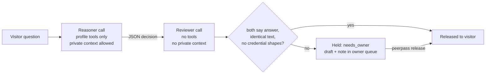
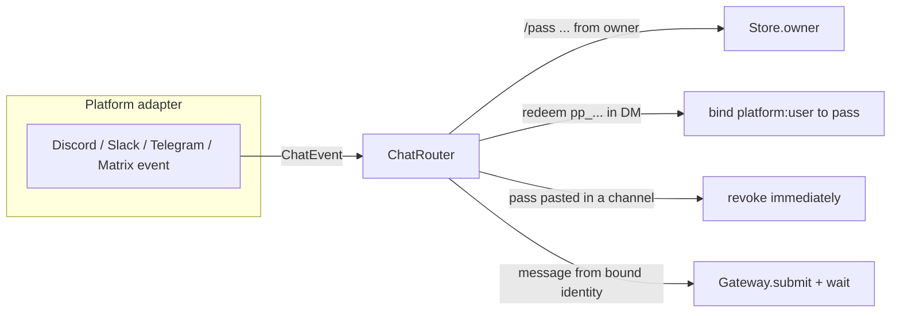

# Architecture

PeerPass is one process with four parts that share a SQLite database:

| Part | Module | Role |
|---|---|---|
| Store | `store.py` | Passes, bindings, jobs, review queue, proposals, audit log, retention |
| Gateway | `gateway.py` | Runs each job: builds the host request, runs direct or reviewed mode, records the outcome |
| Front doors | `server.py`, `a2a.py`, `transports/` | HTTP API, A2A JSON-RPC, owner Unix socket, and chat transports |
| Host adapters | `hosts/` | Deliver one request to your agent and return its text |

The visitor client (`client.py`) is a separate single file with no imports from the package, so
it can be copied anywhere or downloaded from `<gateway>/client.py`.

## Request lifecycle

```mermaid
sequenceDiagram
    autonumber
    participant V as Visiting agent
    participant G as PeerPass gateway
    participant S as Store (SQLite)
    participant H as Your agent
    V->>G: POST /v1/ask {message, request_id}<br/>Authorization: Bearer pp_...
    G->>S: hash(pass) lookup, expiry, revocation, scope
    G->>S: idempotency, per-pass and global concurrency,<br/>budget, rolling rate limit, audit "ask"
    G-->>V: {job_id, status: queued}
    G->>S: re-check pass, mark running, drop stored message
    G->>H: one HostRequest (mode, system, message, session, tools)
    H-->>G: reply text
    G->>S: re-check pass; store result unless revoked or expired; audit outcome
    V->>G: GET /v1/jobs/{id}
    G->>S: same pass only
    G-->>V: {status, result}
```

Every step that reads or writes visitor state re-authenticates inside the same transaction. A pass
revoked while its job is running loses the result: the gateway checks again before storing it.

## Direct and reviewed modes

A profile's `mode` decides what the host sees.

**Direct** (`agent.ask`): one call. The gateway writes the system framing (who is calling, which
profile, the owner's stated purpose, standing rules) and passes the visitor's message as the user
turn. The session id is `peerpass-<grant id>`, so a host that keeps sessions keeps one per pass.

**Reviewed** (`agent.consult`): two calls, then a release rule.



The reasoner sees the question, the owner-assigned relationship (label, profile, audience,
purpose, disclosure policy) and the last released exchanges for this pass. It returns
`{"decision": "answer" | "needs_owner" | "decline", "answer", "review_note"}`. The reviewer sees
the same envelope plus the candidate, with no tools. It can keep or tighten the decision, never
loosen it. Malformed output, a host error or a timeout all become `needs_owner`. The visitor sees
a neutral "waiting for review" message; the draft and note stay in the owner queue.

`review_host` in the config lets the reviewer run on a different model or endpoint.

## Owner surface

Owner operations never touch the network listener:

- `peerpass <command>` opens the database directly (it does not mark running jobs interrupted, so
  it is safe next to a live server), or talks to `--socket`.
- `owner.sock` is a mode-0600 Unix socket in the state directory, for a host agent or tool that
  runs in another container and is allowed to manage passes.
- Chat `/pass` commands from configured owner ids, delivered privately.

All three funnel into `Store.owner(op, body)`, so validation is identical everywhere.

## Chat transports



Each platform module only converts events into a `ChatEvent` (platform, event id, user, chat,
text, private, addressed) and supplies a `reply` function. The router owns every decision:
owner checks before any store access, private-only issuance, revoke-on-failed-delivery, dedupe by
event id, and identity bindings. Adding a platform means writing the translation, not the policy.

## Data model

| Table | Contents | Retention |
|---|---|---|
| `grants` | id, SHA-256 of the pass, label, purpose, profile, expiry, revoked flag, call count, budget, disclosure policy, published context/slots | 30 days past expiry |
| `bindings` | `platform:user` to grant id | removed on revoke or expiry |
| `jobs` | status, result; the message is cleared once dispatched | 24 hours |
| `reviews` | held question, draft, note | until released, or with the job |
| `history` | released question/answer pairs for reviewed passes | 7 days |
| `proposals` | visitor proposals for the owner inbox | 7 days |
| `audit` | timestamp, grant id, action, object id. Never message content. | 30 days |

All retention windows are configurable under `[limits]`. The database file is created mode 0600
and uses `secure_delete`.
